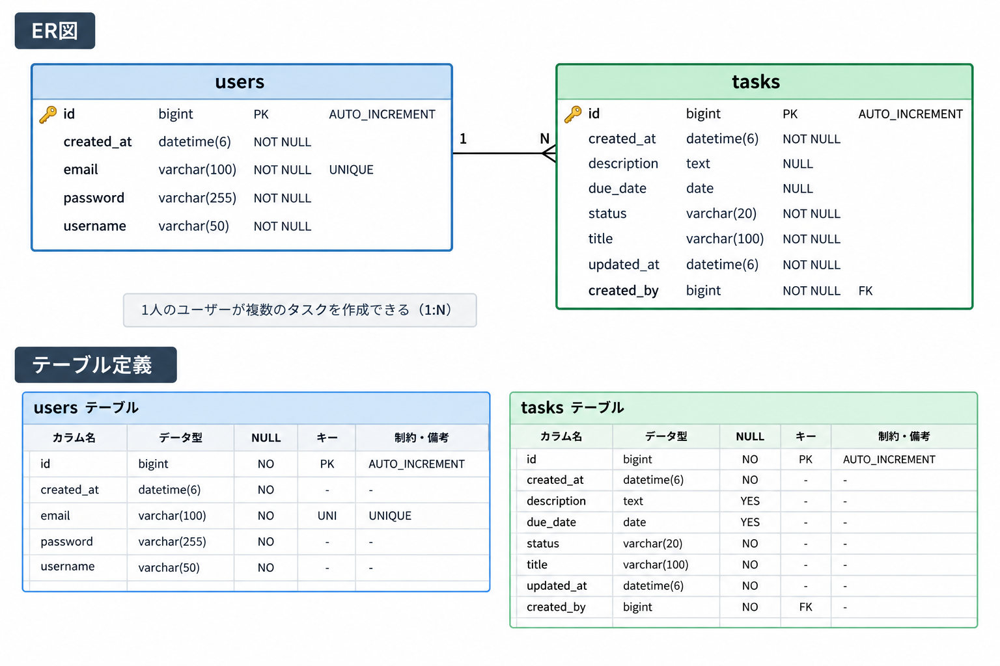
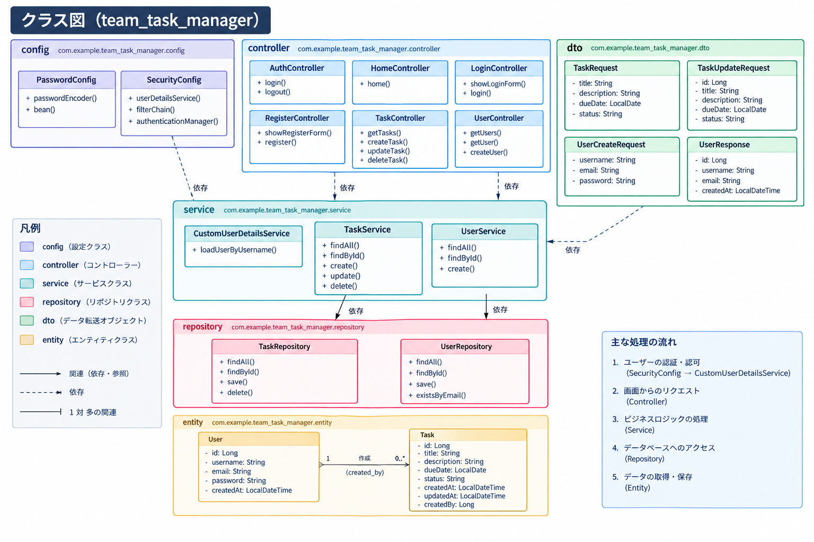

# Team Task Manager

Java・Spring Boot・MySQLで開発した、チーム向けタスク管理Webアプリケーションです。

## 概要

ユーザー登録・ログイン機能を備え、ログイン中のユーザーが自分のタスクを管理できるWebアプリケーションです。

タスクの登録・編集・削除に加え、キーワード検索、ステータスによる絞り込み、入力チェックなどの機能を実装しています。

## 主な機能

- ユーザー登録・ログイン・ログアウト
- BCryptによるパスワードのハッシュ化
- タスクの新規登録・一覧表示・編集・削除
- タスク名によるキーワード検索
- ステータスによる絞り込み
- キーワード検索とステータス絞り込みの組み合わせ
- タスク名・説明の入力チェックと文字数制限
- ステータスの入力値検証
- ログインユーザーごとのタスク表示制御
- 作成日時・更新日時の管理
- レスポンシブ対応の画面デザイン
- JUnit・Mockitoによる自動テスト

## 使用技術

| 分類 | 技術 |
|---|---|
| 言語 | Java 21 |
| フレームワーク | Spring Boot 4.0.8 |
| セキュリティ | Spring Security |
| データベース | MySQL 8.0 |
| ORM | Spring Data JPA / Hibernate |
| テンプレートエンジン | Thymeleaf |
| 入力チェック | Jakarta Bean Validation |
| ビルドツール | Maven Wrapper |
| テスト | JUnit 5 / Mockito |
| 開発環境 | VS Code |

## 動作環境

- Java 21
- MySQL 8.0系
- Maven Wrapperを実行できる環境

## セットアップ・起動方法

### 1. データベースを作成する

MySQLで次のSQLを実行します。

```sql
CREATE DATABASE team_task_manager
    CHARACTER SET utf8mb4
    COLLATE utf8mb4_0900_ai_ci;
```

### 2. データベース接続情報を設定する

`src/main/resources/application.properties` に、データベースの接続先、ユーザー名、パスワードの設定を行います。

パスワードは環境変数 `DB_PASSWORD` から読み込む構成です。実際のパスワードをソースコードやGitHubに登録しないでください。

### 3. 環境変数を設定する

Windows PowerShellの場合、次のコマンドで環境変数を設定できます。

```powershell
$env:DB_PASSWORD = "MySQLのパスワード"
```

この設定は、現在のPowerShellセッションで有効です。アプリケーションを起動するターミナルで設定してください。

### 4. アプリケーションを起動する

プロジェクトのルートフォルダで、次のコマンドを実行します。

```powershell
.\mvnw.cmd spring-boot:run
```

起動後、ブラウザで次のURLにアクセスします。

http://localhost:8080

### 5. 自動テストを実行する

Windows PowerShellの場合、次のコマンドを実行します。

```powershell
.\mvnw.cmd clean test
```

テスト結果はMavenのログおよび `target/surefire-reports` で確認できます。

## 開発状況

ユーザー認証、タスク管理、検索・絞り込み、入力チェック、画面デザイン、設計資料の作成まで実装済みです。

自動テストは合計23件で、すべて成功することを確認しています。

## 開発手順

### STEP 1：開発環境の構築・プロジェクト作成
- Java 21の開発環境を準備
- VS CodeでSpring Bootプロジェクトを作成
- 必要な依存関係を設定
- Maven Wrapperでビルドできることを確認

### STEP 2：Java・Mavenの実行環境設定
- Javaのインストール先を確認
- `JAVA_HOME` などの環境変数を設定
- 開発環境からJavaを認識できるように調整

### STEP 3：MySQLデータベースの接続設定
- MySQLの接続状態を確認
- `team_task_manager` データベースを作成
- `application.properties` に接続情報を設定
- 環境変数 `DB_PASSWORD` からパスワードを読み込むように設定

### STEP 4：ユーザー登録機能の実装
- `User` エンティティと `UserRepository` を作成
- `UserService` でユーザー登録処理を実装
- `UserController` と登録画面を作成
- パスワードのハッシュ化を実装

### STEP 5：ログイン・ログアウト機能の実装
- ログイン画面とダッシュボードを作成
- ログイン・ログアウト処理を実装
- 認証状態に応じた画面遷移を確認

### STEP 6：ユーザー認証・セキュリティ設定
- Spring Securityを設定
- BCryptによるパスワードハッシュ化を実装
- `CustomUserDetailsService` によるユーザー認証を実装
- ログインにメールアドレスを使用する仕組みを設定

### STEP 7：タスク管理用のDB・クラスの作成
- `Task` エンティティを作成
- `TaskRepository`、`TaskService`、`TaskController` を作成
- タスクと登録ユーザーを関連付け
- 作成日時・更新日時を自動設定する仕組みを実装

### STEP 8：タスクの登録・編集・削除機能の実装
- タスクの新規登録・一覧表示・編集・削除を実装
- 削除時の確認ダイアログを追加
- データベースへの保存・更新・削除を確認

### STEP 9：タスク名検索・ユーザー別表示・入力チェック
- ログイン中のユーザーが登録したタスクだけを表示
- タスク名のキーワード検索を実装
- 検索解除による一覧表示への復帰を実装
- タスク名の必須チェックと文字数制限を実装

### STEP 10：ステータスによる絞り込み機能
- 「未着手」「進行中」「完了」の選択欄を追加
- ステータスによる絞り込みを実装
- キーワード検索との組み合わせに対応

### STEP 11：入力チェック・ステータスの検証強化
- 編集用DTO `TaskUpdateRequest` を作成
- 新規登録・編集の両方で入力チェックを実装
- タスク名・説明の文字数制限を設定
- ステータスを許可された値に制限
- 入力エラーメッセージの表示を確認

### STEP 12：画面デザインの改善
- タスク一覧をカード形式で表示
- ステータスごとの色分け
- 編集・削除ボタンのデザイン調整
- 検索フォームのデザイン調整
- レスポンシブレイアウトに対応

### STEP 13：テストの追加・動作確認
- `TaskRequest` の入力チェックテスト
- `TaskUpdateRequest` の入力チェックテスト
- `TaskService` の単体テスト
- `UserService` の単体テスト
- Spring Bootの起動確認テスト
- 合計23件の自動テストが成功することを確認

### STEP 14：ER図・クラス図の作成
- `users` と `tasks` のテーブル構造を整理
- `tasks.created_by` と `users.id` の関連を整理
- ER図を作成
- Javaクラスの構成と依存関係を整理し、クラス図を作成

### STEP 15：README作成・最終確認
- アプリケーションの概要と機能を記載
- 使用技術と動作環境を記載
- セットアップ・起動・テスト実行手順を記載
- 設計資料へのリンクを追加

### STEP 16：タスク管理機能の動作確認
- ダッシュボードとタスク一覧の画面遷移を確認
- タスクの登録・編集・削除を確認
- キーワード検索とステータス絞り込みを確認
- 検索条件を組み合わせた動作を確認

### STEP 17：入力チェック・期限表示の修正と最終テスト
- 新規登録・編集時の入力チェックを確認
- 不正なステータスが保存されないことを確認
- 編集画面で期限が正しく表示されるように修正
- 期限を変更せずに保存しても値が保持されることを確認
- 自動テスト23件の成功を確認

### STEP 18：変更内容の確認・Git管理
- 変更ファイルの差分を確認
- コミット前に変更内容を確認
- SourceTreeでステージング・コミットを実施

## 設計資料

### ER図

データベースのテーブル構成とリレーションを示します。



### クラス図

アプリケーションのクラス構成と依存関係を示します。


